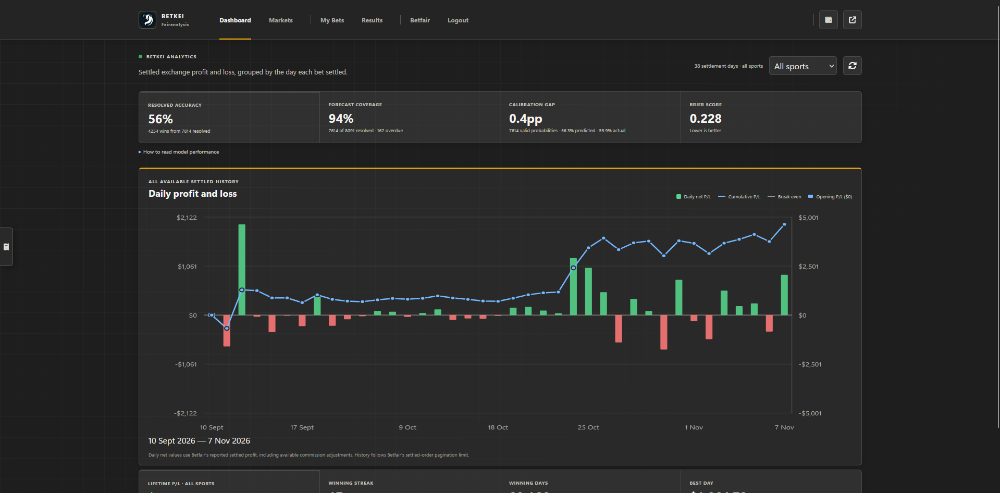
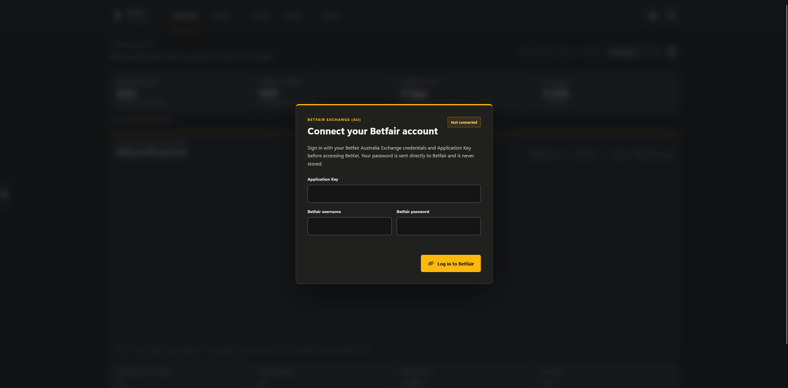
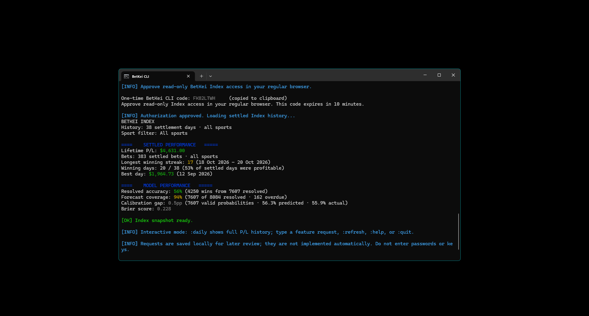

# BetKei Fairanalysis

BetKei brings sports-market analysis, historical model results, and authorized Betfair Exchange account tools together in the SKUNKEI platform. It is a private, authenticated service for eligible users, not a public betting service or an autonomous betting bot.

BetKei estimates and historical performance are informational only. Markets, prices, event coverage, and model estimates can be incomplete or change; past results do not guarantee future outcomes. Betting involves risk of loss.

## Ways to use BetKei

### BetKei website

The website is the primary BetKei workspace. Depending on account permissions and service configuration, authorized users can:

- Browse supported fixtures by sport and league, search events, and view available Betfair Exchange AU prices.
- Review market-implied estimates, optional historical-form context, prediction results, and model performance.
- View connected Betfair account information, open orders, and settled history.
- Where enabled, submit a real BACK order after selecting a runner, reviewing the price and stake, and explicitly confirming the order in the website.

Prices can be delayed, unavailable, suspended, or change before an action is confirmed. BetKei presents a model estimate only when the market has a complete set of usable runner prices; the interface indicates whether historical-form data contributes to the estimate.

Predictions do not place orders automatically. A submitted order can be unmatched, rejected, delayed, or otherwise change state; check BetKei and Betfair directly if a result is unclear.

Website: [betkei.skunkei.com](https://betkei.skunkei.com/)

### Estimates and performance

The current estimate starts from available exchange prices. BetKei converts decimal odds to implied probabilities and normalizes them across the market to account for the overround. When sufficient two-team historical-form data is available, a bounded form adjustment may be applied. Incomplete or invalid prices mean no model estimate is shown for that market.

An estimate is not a calibrated promise of an event's true probability. Market quality and freshness, event/runner matching, historical coverage, and form-sample quality all affect it; model rules may change as the service evolves.

- **Model accuracy** summarizes resolved predictions in the displayed data; it does not forecast future accuracy.
- **Pick accuracy** covers the smaller set of predictions that meet the qualifying-pick criteria. Consider its sample size and resolution coverage.
- **Brier score and calibration gap** describe aspects of historical probability quality, not guaranteed future calibration.
- **Projected P/L** is a notional model calculation. It is not the user's actual Betfair return and may omit real execution effects and costs.
- **Settled Betfair P/L** comes from connected-account bet records and is distinct from projected model P/L.

Historical outcomes can be incomplete, delayed, or affected by event and runner matching. Interpret performance alongside its sample size, coverage, period, and available-data indicators.

### Integrations and account security

Betfair Exchange AU provides markets, runner prices, account information, and order actions for authorized connections. TheSportsDB provides supported event schedules, scores, results, and historical sports data where available. Provider availability, sport and league coverage, market type, and event matching vary; a listed sport does not guarantee a market, complete prices, form data, or a forecast.

BetKei requires an authenticated account with the appropriate section privileges. Betfair connection and live order actions require additional authorization and may be disabled by service configuration. The service uses account access checks, CSRF protection for state-changing browser requests, server-side validation, and HTTPS on supported production traffic. Betfair passwords are forwarded to Betfair for authentication and are not stored by BetKei; the Betfair application key and session token are encrypted at rest. These measures describe the current implementation and do not guarantee that an account, device, or network cannot be compromised.

Protect both your SKUNKEI and Betfair accounts. Do not share credentials or session details. If an order request times out or its final state is unclear, check the Betfair account directly before taking further action.

### Android application

BetKei integration into the SKUNKEI Android app is in development and planned for a future release. It is not available yet; currently, use the website to manage BetKei analysis and any enabled, user-confirmed Betfair actions. Do not rely on the Android app to place, monitor, or cancel BetKei orders until that integration is released.

### Command-line interface

The `betkei-cli` directory contains a Python CLI for viewing a read-only BetKei Index snapshot. It uses browser-based, PKCE device authorization and a short-lived, read-only token. It can print model metrics and settled P/L history, including a full table with `:daily` in its interactive prompt.

The CLI **cannot place or cancel bets**, change account settings, or access general BetKei API routes. It is not an automated betting client. A connected system Betfair session is required for settled Betfair data.

## Access and components

BetKei is private-use-only. CLI access requires an eligible BetKei super-administrator account, CLI Code Authentication enabled in account settings, and explicit approval in a regular browser. Installing the CLI does not grant service access.

The website and APIs run as part of the SKUNKEI service. The CLI has separate server-side endpoints and schema requirements documented in its README. This repository is an overview and CLI source package, not a standalone deployment of the BetKei website or backend.

## Responsible use

BetKei is not financial or betting advice and does not promise outcomes or returns. Use exchange features only where lawful, with an account you are authorized to use, and only after checking the event, selection, price, stake, and order status. Set limits and do not chase losses.

## License

The CLI source is distributed under the license included in [`betkei-cli/LICENSE`](betkei-cli/LICENSE). Service access remains restricted independently of that source-code license. Website and Android components may have separate distribution terms.